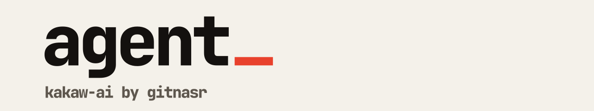

<picture>
  <source media="(prefers-color-scheme: dark)" srcset=".github/banner-dark.svg">
  
</picture>

The agent behind [Kakaw AI](https://kakaw.gitnasr.com). It takes a question in plain English, writes SQL for the connected database, runs it, and returns the answer as a table or a chart.

[Backend](https://github.com/Kakaw-AI/backend) · [Frontend](https://github.com/Kakaw-AI/frontend) · [Monitoring](https://github.com/Kakaw-AI/monitoring) · [Site](https://kakaw.gitnasr.com)

## How it works

A LangGraph pipeline in TypeScript, calling models through LangChain (Anthropic, OpenAI and Google are installed; the product also lists Ollama and LM Studio). The code in `src/`:

| Folder | What it does |
| --- | --- |
| `pipeline`, `graph` | The question-to-answer flow, field resolution, chart specs |
| `llm` | Model calls, caching, intent, answers, MCP tools |
| `prompts` | Prompt text |
| `database` | Schema index, knowledge, query execution, row inference |
| `server.ts` | HTTP entry point (port 8000 in the image) |
| `telemetry.ts` | OpenTelemetry setup |

SQL is checked before it runs (`src/database/safety.ts`): one statement only, starting with `SELECT`, `WITH`, `EXPLAIN` or `PRAGMA`, and anything that writes or changes the schema is rejected.

## Run it

```bash
yarn install
yarn dev        # tsx watch src/server.ts
```

| Script | |
| --- | --- |
| `yarn build` | Compile with `tsc` |
| `yarn start` | Run `dist/server.js` with OpenTelemetry hooks |
| `yarn test` / `test:watch` | Vitest |

## Configuration

Settings come from Infisical (`src/config/infisical.ts`). The backend calls this service with an internal auth token. Never commit a `.env` file.

## Docker

`node:22-alpine`, multi-stage, exposes port 8000. CI builds and publishes the image on pushes to `master` and on `v*` tags.
